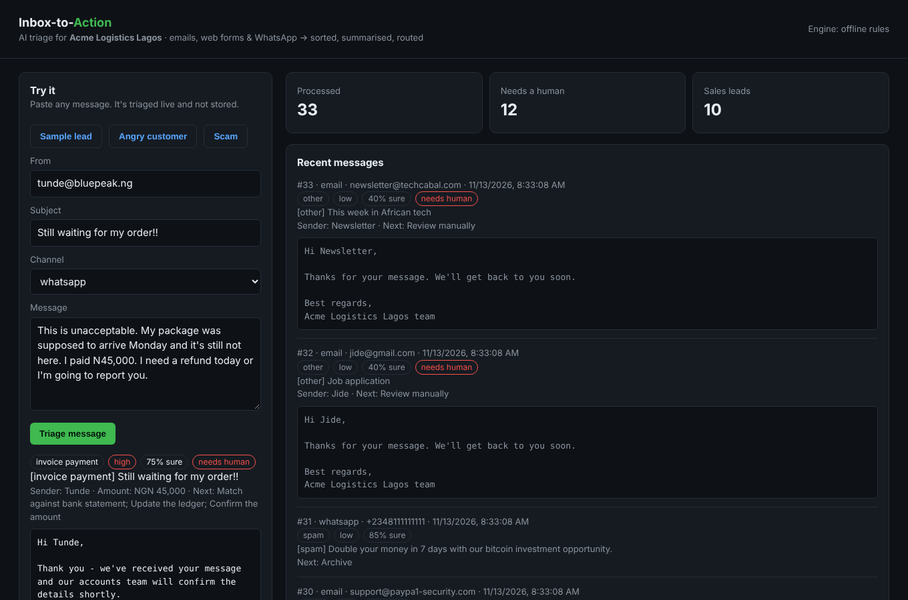
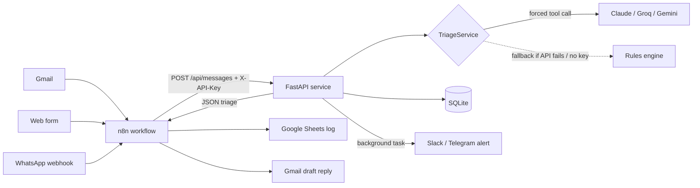

# Inbox-to-Action 📥 → ✅

**An AI agent that reads a small business's inbound messages (email, web forms, WhatsApp), decides what each one is, pulls out the key details, drafts a reply, and routes it to the right place automatically.**

[](https://github.com/MartinezYT/inbox-to-action/actions/workflows/ci.yml)
    

🔗 **Live demo:** https://inbox-to-action.onrender.com  ·  📖 **API docs:** https://inbox-to-action.onrender.com/docs



---

## The problem

A Lagos logistics SME gets 50–200 messages a day across Gmail, its website form, and WhatsApp. Sales leads get buried under invoices and spam, angry customers wait hours for a reply, and nobody knows which payments came in. Someone spends 2–3 hours a day just *sorting*.

## What it does

For every message, Inbox-to-Action returns a structured decision in about 1–2 seconds:

| Field | Example |
|---|---|
| `category` | `sales_lead` · `support` · `invoice_payment` · `partnership` · `spam` · `other` |
| `urgency` | `high` (money at risk / angry / <48h deadline) · `medium` · `low` |
| `summary` | "Skincare brand wants a quote for ~40 Lagos deliveries/week, ₦800k budget." |
| `amount` / `currency` | `800000` / `NGN` (understands "N800k", "₦45,000", "2.5m naira") |
| `action_items` | `["Send a quote", "Add lead to CRM"]` |
| `suggested_reply` | A ready-to-send draft, signed by the business |
| `needs_human` | `true` for refunds, legal threats, big amounts, or low confidence |

Then it **acts**: saves the message, alerts the team on Slack/Telegram for leads and urgent issues, and (through the included n8n workflow) logs every message to Google Sheets and creates Gmail draft replies for leads.

## Architecture



**Pick your engine**

| Engine | Env var | Cost | Default model |
|---|---|---|---|
| Claude (recommended) | `ANTHROPIC_API_KEY` | Paid, a few cents per 100 messages | `claude-haiku-5-5` |
| Groq | `GROQ_API_KEY` | Free tier, no card | `openai/gpt-oss-120b` |
| Gemini | `GEMINI_API_KEY` | Free tier | `gemini-2.5-flash` |
| Rules (offline) | none | Free | keyword + regex engine |

With `TRIAGE_MODE=auto` (the default) the first engine with a key wins, in that order. Groq and Gemini go through their OpenAI-compatible APIs with a forced function call, so every engine returns the same validated `Triage` object.

**Key design decisions**

- **Guaranteed structured output.** Claude is called with a single tool (`record_triage`) whose JSON schema is generated from the Pydantic `Triage` model, and `tool_choice` forces that tool. The output is validated by Pydantic, so downstream code never parses free text.
- **Never fails the webhook.** If the Claude call errors or returns invalid data, the service falls back to a deterministic rules engine and records `engine: "rules-fallback"`. Automations upstream (n8n, Zapier) never see a 500.
- **Prompt-injection aware.** Message content is wrapped in tags and the system prompt tells the model to treat it as data. The dashboard renders text with `textContent`, never `innerHTML`.
- **Measured, not guessed.** `evals/` holds 24 labelled messages and a script that reports category/urgency accuracy, so a prompt or model change is judged on numbers.
- **Safe by default.** Writes need an `X-API-Key` (compared in constant time). The public dashboard and the `/api/try` playground only exist when `DEMO_MODE=true` and are rate-limited.

## Quick start

```bash
git clone https://github.com/MartinezYT/inbox-to-action.git
cd inbox-to-action
python -m venv .venv && source .venv/bin/activate      # Windows: .venv\Scripts\activate
pip install -r requirements-dev.txt
cp .env.example .env                                    # add ANTHROPIC_API_KEY (optional)

DEMO_MODE=true uvicorn app.main:app --reload            # Windows PowerShell: $env:DEMO_MODE="true"; uvicorn app.main:app --reload
```

Open http://localhost:8000 for the dashboard and http://localhost:8000/docs for interactive API docs. Load sample data in a second terminal:

```bash
python scripts/send_samples.py
```

No API key? It still works: the offline rules engine takes over (the header shows which engine is active).

### Example request

```bash
curl -X POST https://inbox-to-action.onrender.com/api/messages \
  -H "Content-Type: application/json" -H "X-API-Key: $API_KEY" \
  -d '{"sender":"sade@homeessentials.ng","subject":"Refund request","channel":"email",
       "body":"I was charged twice for order #8831 (N18,500 each). Please refund the duplicate payment today."}'
```

Real response from the live deployment (Groq engine):

```json
{
  "id": 14,
  "engine": "groq",
  "triage": {
    "category": "invoice_payment", "urgency": "high", "confidence": 0.99,
    "summary": "Customer requests refund for a duplicate payment on order #8831.",
    "company": "Home Essentials", "amount": 18500, "currency": "NGN", "needs_human": true,
    "action_items": ["Verify duplicate charge for order #8831", "Process refund of NGN 18500"],
    "suggested_reply": "Hello,\n\nThank you for contacting us. We've received your request regarding the duplicate charge for order #8831 and will investigate this promptly..."
  }
}
```

Note `needs_human: true`: the prompt forbids the AI from promising refunds, so a person signs off first.

## API

| Method | Path | Auth | Purpose |
|---|---|---|---|
| `POST` | `/api/messages` | `X-API-Key` | Triage + store + alert (the webhook n8n calls) |
| `GET` | `/api/messages?category=&limit=` | key, or public in demo | List processed messages |
| `GET` | `/api/messages/{id}` | key, or public in demo | One message |
| `GET` | `/api/stats` | key, or public in demo | Counts by category/urgency |
| `POST` | `/api/try` | demo only, rate-limited | Playground; result not stored |
| `GET` | `/health` | public | Status + active engine |

## Evaluation

```bash
python -m evals.run_eval -v                 # Claude (if key set)
python -m evals.run_eval --url https://inbox-to-action.onrender.com   # measure the deployed app; key stays on the server
TRIAGE_MODE=rules python -m evals.run_eval  # offline baseline
```

| Engine | Category accuracy | Urgency accuracy |
|---|---|---|
| Rules baseline (offline) | 24/24 (100%)* | 21/24 (88%) |
| Groq (`openai/gpt-oss-120b`), live deployment | 23/24 (96%) | 21/24 (88%) |
| Claude (`claude-haiku-5-5`) | not measured yet | not measured yet |

Groq's only category miss was a tech newsletter labelled `spam` instead of `other`; its urgency misses all rated low-priority partnership/enquiry messages one notch higher (`medium`). Measured on 13 Nov 2026 against https://inbox-to-action.onrender.com.

\*The rules engine's keywords were written alongside this small dataset, so it's a sanity baseline, not a real-world score. The interesting number is Claude's on messages it has never seen. Add your own real (anonymised) messages to `evals/dataset.jsonl` to test that.

## n8n workflow

`n8n/workflow.json` connects the real inboxes: **Gmail Trigger / Webhook → Normalise → Inbox-to-Action API → Google Sheets log → if lead → Gmail draft reply**.

1. In n8n: **Workflows → Import from file** → pick `n8n/workflow.json`.
2. Set the env vars `INBOX_API_URL` and `INBOX_API_KEY` in n8n (or paste the values straight into the HTTP Request node).
3. Connect your Gmail and Google Sheets credentials, and paste your Sheet URL into the Sheets node. The sheet needs a tab called `Inbox` with these headers: `id, received_at, sender, channel, category, urgency, summary, amount, currency, needs_human, suggested_reply`.

## Deploy (free) on Render

1. Push this repo to GitHub.
2. On [render.com](https://render.com): **New + → Blueprint →** select the repo. `render.yaml` sets everything up.
3. Paste your `ANTHROPIC_API_KEY` when prompted. Render generates `API_KEY` for you.
4. With `DEMO_MODE=true`, the app loads the 24 sample messages by itself whenever its database is empty (set `SEED_DEMO_DATA=false` to turn that off).

The free tier sleeps when idle, so the first request after a while takes ~30s. The SQLite file resets on redeploy, which is fine for a demo. Use Postgres for real data.

Or run anywhere with Docker:

```bash
docker build -t inbox-to-action .
docker run -p 8000:8000 --env-file .env inbox-to-action
```

## Project structure

```
app/
  main.py        FastAPI routes, auth, rate limiting
  triage.py      Claude engine (forced tool use) + rules engine + fallback facade
  models.py      Pydantic schemas (the single source of truth for the AI's output)
  store.py       SQLite persistence
  notify.py      Slack / Telegram alerts
  dashboard.py   Single-file demo dashboard
evals/           Labelled dataset + accuracy script
tests/           37 pytest tests (Claude is faked, so they run offline and cost nothing)
n8n/             Importable automation workflow
.github/         CI: lint, tests, eval threshold, Docker build
```

## Built with Claude Code

I used [Claude Code](https://claude.com/claude-code) as a pair programmer: scaffolding the service, writing the test suite (including the fake Claude client), and iterating on the prompt against the eval set. Project conventions for the agent are in [`CLAUDE.md`](CLAUDE.md).

## Roadmap

- [ ] WhatsApp Cloud API webhook adapter
- [ ] Postgres + Alembic migrations
- [ ] Prompt caching + batch mode for high-volume inboxes
- [ ] Human-in-the-loop: approve/edit the suggested reply from Slack
- [ ] Per-business custom categories via config

## License

MIT
